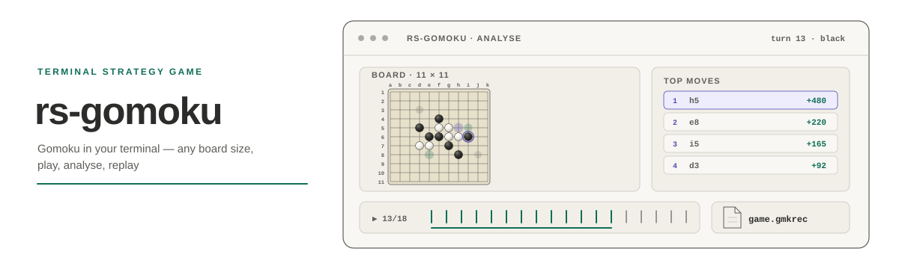

<p align="center"></p>

[English](README.md) | **日本語**

# rs-gomoku

ターミナルで遊ぶ五目並べです．盤は 7 × 7 から 19 × 19 まで選べます．脅威と詰み筋を探す CPU と対戦でき，自由ルールと標準ルールを切り替えられ，候補手の評価を盤上に表示できます．`.gmkrec` 形式の棋譜ファイルから対局を再生でき，録画にも使えます．表示は英語と日本語を切り替えられます．描画には [ratatui](https://ratatui.rs) を使っています．

## インストール

```sh
cargo install --git https://github.com/akitenkrad/rs-gomoku
```

クローンして実行する場合:

```sh
cargo run --release
```

N × N の盤には，幅 `3N + 42`，高さおよそ `N + 12` の端末が必要です（15 × 15 なら 87 × 27）．True Color（24bit）対応の端末を推奨します．

## クイックスタート

```sh
rs-gomoku                                                 # play on 15 x 15
rs-gomoku --size 19 --rule standard                       # 19 x 19, exactly five wins
rs-gomoku replay examples/records/black-wins-15.gmkrec    # replay a game record
```

## ドキュメント

- [遊び方](docs/gameplay.ja.md) — ルール，盤のサイズ，座標，設定，操作
- [戦略と探索](docs/strategy.ja.md) — 脅威，四三，CPU の探索
- [棋譜とリプレイ](docs/replay.ja.md) — `.gmkrec` 形式，リプレイのオプション，録画
- [開発者向け情報](docs/development.ja.md) — ソース構成とテスト

[rs-games](https://github.com/akitenkrad/rs-games)（Rust 製ターミナルゲームのコレクション）に収録しています．

## ライセンス

[MIT](LICENSE)
