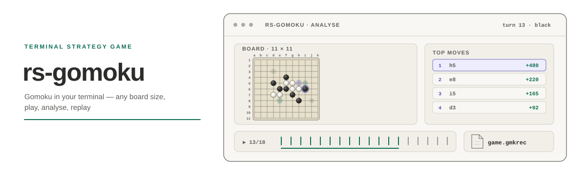

<p align="center"></p>

**English** | [日本語](README.ja.md)

# rs-gomoku

Gomoku (five in a row) in your terminal, on any board from 7 × 7 to 19 × 19. Play against a CPU that searches for threats and forced wins, choose freestyle or standard rules, see candidate moves scored on the board, and replay recorded games from `.gmkrec` files — handy for recording videos. The interface is in English or Japanese. Built with [ratatui](https://ratatui.rs).

## Install

```sh
cargo install --git https://github.com/akitenkrad/rs-gomoku
```

Or from a clone:

```sh
cargo run --release
```

The terminal needs `3N + 42` columns and about `N + 12` rows for an N × N board (87 × 27 for 15 × 15); true colour (24-bit) is recommended.

## Quick start

```sh
rs-gomoku                                                 # play on 15 x 15
rs-gomoku --size 19 --rule standard                       # 19 x 19, exactly five wins
rs-gomoku replay examples/records/black-wins-15.gmkrec    # replay a game record
```

## Documentation

- [Playing rs-gomoku](docs/gameplay.md) — rules, board size, coordinates, settings and controls
- [Strategy and search](docs/strategy.md) — threats, the four-three, and how the CPU searches
- [Game records and replay](docs/replay.md) — the `.gmkrec` format, replay options and recording videos
- [Development](docs/development.md) — source layout and tests

Part of [rs-games](https://github.com/akitenkrad/rs-games), a collection of terminal games written in Rust.

## License

[MIT](LICENSE)
